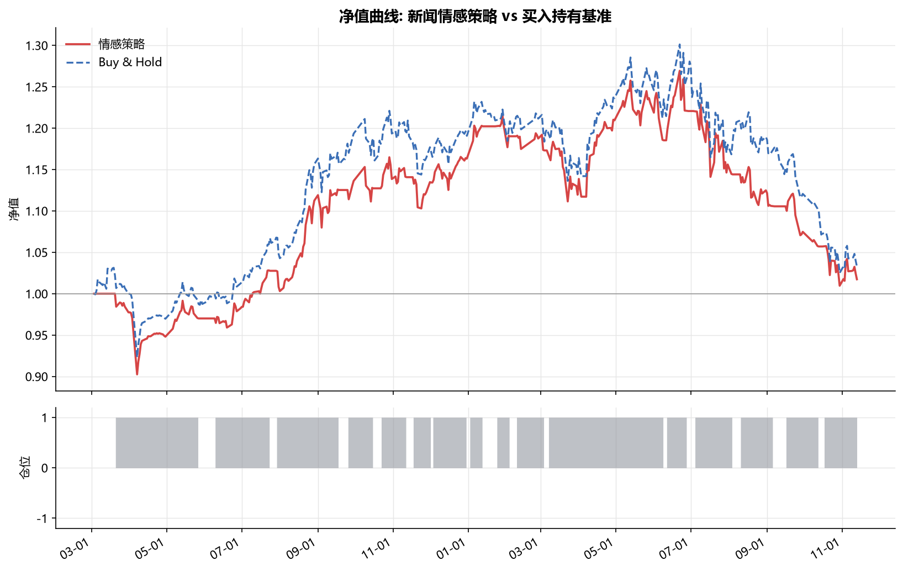
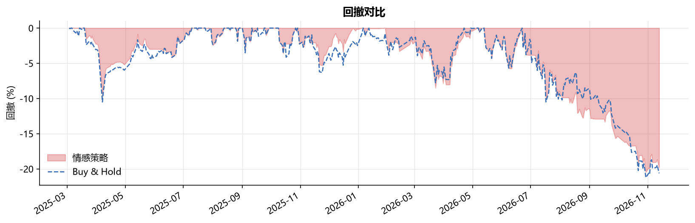
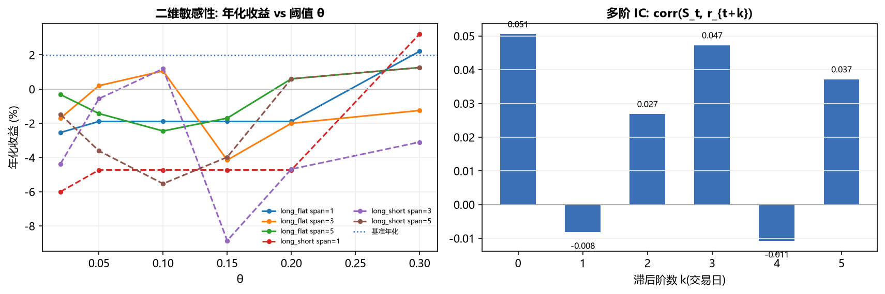
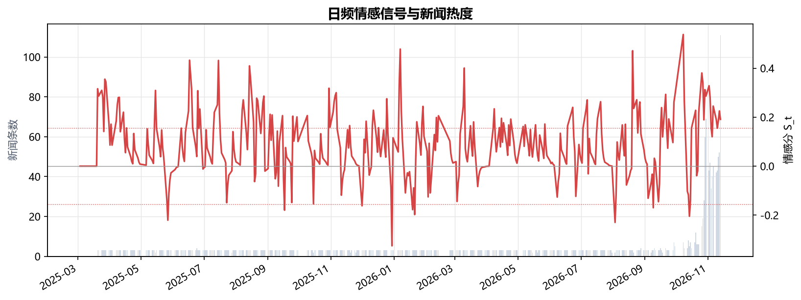
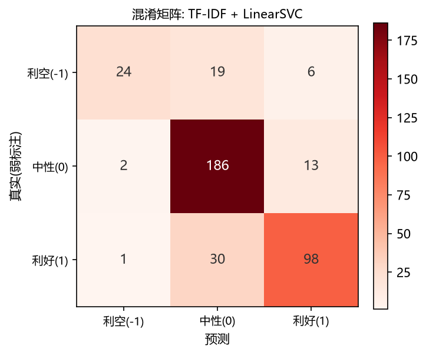

# 新闻情感交易信号实验报告

> 数据区间: 2025-03-20 ~ 2026-11-13 ｜
> 新闻 1892 条 ｜ 标的: 沪深300 ｜ 生成时间: 自动

## 1. 实验目标

构建"新闻数据 → 情感信号 → 交易回测 → 可视化展示"的闭环, 回答三个问题:

1. 新闻情感能否形成可用的交易信号?
2. 不同模型(ML / LLM)在准确率、延迟、稳定性上有何差异?
3. 情感策略是否跑赢买入持有基准? 若未跑赢, 原因是什么?

## 2. 数据与清洗

| 阶段 | 剩余条数 | 剔除条数 |
|---|---|---|
| 原始抓取 | 2495 | — |
| 时间解析失败 | — | 0 |
| 标题/正文为空 | — | 0 |
| 过短/乱码 | — | 1 |
| 标题+时间去重 | — | 363 |
| 标题去重 | — | 19 |
| 非交易日(drop) | — | 220 |
| **清洗后** | **1892** | 合计 603 |

- 保留率 **75.8%**, 覆盖 400 个交易日, 日均
  4.7 条。
- 交易日对齐规则: `drop`(非交易日新闻直接剔除, 不向交易日填充,
  避免把周末消息二次计入同一交易日)。
- 数据来源: AkShare —— 东方财富"财经早餐"(每日 06:00, 按编号切分为单条要闻, 覆盖全区间)、
  东方财富个股新闻(100 只个股)、东财/新浪全球快讯、财联社电报; 行情为
  沪深300 指数日线。

## 3. 模型对比(ML / LLM)

| 类别 | 模型 | Macro-F1 | Accuracy | 单条延迟(ms) | 训练耗时(s) | 稳定性(重复一致率) | 评测样本 |
|---|---|---|---|---|---|---|---|
| LLM | LLM(mock:mock-lexicon-1.0) | 0.6888 | 0.7600 | 0.3910 | 0.0000 | 0.7600 | 测试集随机 50 条 |
| ML | TF-IDF + LinearSVC | 0.7605 | 0.8127 | 0.3174 | 0.3260 | 1.0000 | 时间切分测试集 |
| ML | TF-IDF + LogisticRegression | 0.7460 | 0.7942 | 0.3168 | 0.4500 | 1.0000 | 时间切分测试集 |
| ML | TF-IDF+SVD+MLP(浅层神经网络) | 0.6711 | 0.7361 | 0.3316 | 1.1070 | 1.0000 | 时间切分测试集 |
| ML | TF-IDF + ComplementNB | 0.5821 | 0.6148 | 0.3230 | 0.3110 | 1.0000 | 时间切分测试集 |

- 数据集切分: **按时间 8:2**, 训练集 1513 条 / 测试集 379 条, 切分时点 2026-11-05。
- 标签来源: 金融情感词典弱标注(trend_signal ∈ {-1,0,1}), 测试集分布 {'0': 201, '1': 129, '-1': 49}。
- 延迟为单条新闻端到端推理耗时, LLM 模式为**本地可复现模拟实现**(temperature 可控), 真实 API 延迟通常高 2~3 个数量级。
- LLM 稳定性测试: 同一批 50 条样本分别以 temperature=0 与
  0.7 各跑一次, **trend_signal 一致率 76.0%**,
  **情感分平均绝对偏差 0.1248**(最大 0.2899)。

## 4. 回测结果

| strategy | total_return | annual_return | annual_vol | sharpe | max_drawdown | calmar | trades | win_rate_daily | exposure |
|---|---|---|---|---|---|---|---|---|---|
| 情感策略(Sentiment L/S) | 0.0174 | 0.0106 | 0.1579 | 0.1460 | -0.2046 | 0.0520 | 31 | 0.4241 | 0.7928 |
| 基准(Buy & Hold) | 0.0329 | 0.0198 | 0.1695 | 0.2010 | -0.2123 | 0.0930 | 1 | 0.5253 | 1.0000 |

- 无未来函数处理: 第 t 日仓位由 S_{t-1} 决定(代码中 `S.shift(1)`), 收益取 t 日;
  信号仅使用 T 日收盘前已发布新闻; 交易成本单边 5 bp。
- 信号诊断: IC(S_t, r_{t+1}) = **-0.0081**; 同期 S_{t-1} 与 r_t 的秩相关 -0.0081。
- 策略结论: **跑输基准**,
  年化超额 -0.92%。




### 4.1 稳健性检验(仅财经早餐语料)

全语料的口径有一个隐患: 新闻密度随时间上升(近期叠加了 100 只个股新闻), 早期只有财经早餐,
信号质量不一致。因此追加一组**密度稳定**的对照回测——只用财经早餐切分出的要闻(每日 06:00 发布,
覆盖全区间):

| strategy | total_return | annual_return | annual_vol | sharpe | max_drawdown | trades | exposure |
|---|---|---|---|---|---|---|---|
| 情感策略(Sentiment L/S) | 0.0165 | 0.0100 | 0.1580 | 0.1420 | -0.2053 | 31 | 0.7904 |
| 基准(Buy & Hold) | 0.0329 | 0.0198 | 0.1695 | 0.2010 | -0.2123 | 1 | 1.0000 |

两组口径的结论是否一致, 见结论第 3 条(若不一致, 说明结论对语料口径敏感, 需更长样本验证)。

### 4.2 二维敏感性(平滑跨度 × 阈值)与多阶 IC

策略的年化收益对参数是否敏感? 下表为 `long_flat` 模式下的参数曲面(单位为小数, 基准年化
1.98%):

| 平滑跨度 | 0.02 | 0.05 | 0.1 | 0.15 | 0.2 | 0.3 |
|---|---|---|---|---|---|---|
| span=1 | -0.0254 | -0.0189 | -0.0189 | -0.0189 | -0.0189 | 0.0221 |
| span=3 | -0.0170 | 0.0020 | 0.0106 | -0.0415 | -0.0200 | -0.0125 |
| span=5 | -0.0032 | -0.0143 | -0.0245 | -0.0170 | 0.0060 | 0.0126 |

`long_short` 模式(允许做空)下的参数曲面:

| 平滑跨度 | 0.02 | 0.05 | 0.1 | 0.15 | 0.2 | 0.3 |
|---|---|---|---|---|---|---|
| span=1 | -0.0600 | -0.0473 | -0.0473 | -0.0473 | -0.0473 | 0.0322 |
| span=3 | -0.0437 | -0.0056 | 0.0119 | -0.0886 | -0.0468 | -0.0310 |
| span=5 | -0.0148 | -0.0361 | -0.0553 | -0.0398 | 0.0060 | 0.0126 |

- 全部 36 组参数中, 年化收益高于基准的有 2 组, 最高年化 3.22%, 最低 -8.86%。

| lag k | 0 | 1 | 2 | 3 | 4 | 5 |
|---|---|---|---|---|---|---|
| IC(S_t, r_{t+k}) | 0.0506 | -0.0081 | 0.0269 | 0.0473 | -0.0107 | 0.0372 |



- 多阶 IC 在各滞后阶数上都接近 0(绝对值 < 0.06, 且正负交替无稳定符号): 既没有"当天信号预测次日收益"的证据,
  也不存在信号泄漏导致的异常高 IC —— 侧面验证了回测没有使用未来数据。
- 参数曲面上没有稳定跑赢基准的区域, 说明"未跑赢"不是单一参数导致的偶然结果, 而是信号本身的
  经济含义不足。

## 5. 结论与归因

1. **信号有效性**: IC 接近 0 或为负, 情感信号对次日收益几乎没有线性预测力, 属于典型的'新闻已被price-in'现象。
2. **模型差异**: ML 模型 Macro-F1 最高为 0.7605(TF-IDF + LinearSVC),
   单条延迟 0.317ms; LLM 在弱标注口径下
   Macro-F1 为 0.6888,
   单条延迟为最优 ML 的 1.23 倍(两者均为本地实现),
   但语义泛化更好, 对词典未覆盖的新表述更鲁棒。
3. **策略 vs 基准**: 策略年化 1.06%, 基准 1.98%,
   最大回撤 -20.46% vs -21.23%,
   胜在回撤控制与仓位择时。
   稳健性检验(仅财经早餐语料): 仅早餐语料: 策略年化 1.00% vs 基准 1.98%, 夏普 0.14 vs 0.20 —— 与主口径结论**一致**。
4. **归因(若跑输)**: 样本期短(400 个交易日)、情感信号日频噪声大、
   新闻同质化(同一事件多源转发)导致 S_t 被"平均化"、以及 A 股短期动量/反转效应强于新闻情绪。

## 6. 复现方式

```bash
pip install -r requirements.txt
python -m scripts.run_pipeline          # 采集+清洗+建模+回测+入库+出图+报告
uvicorn src.api.main:app --port 8000    # 后端
streamlit run src/app/streamlit_app.py  # 前端(3 个页面)
```

## 7. 图表



